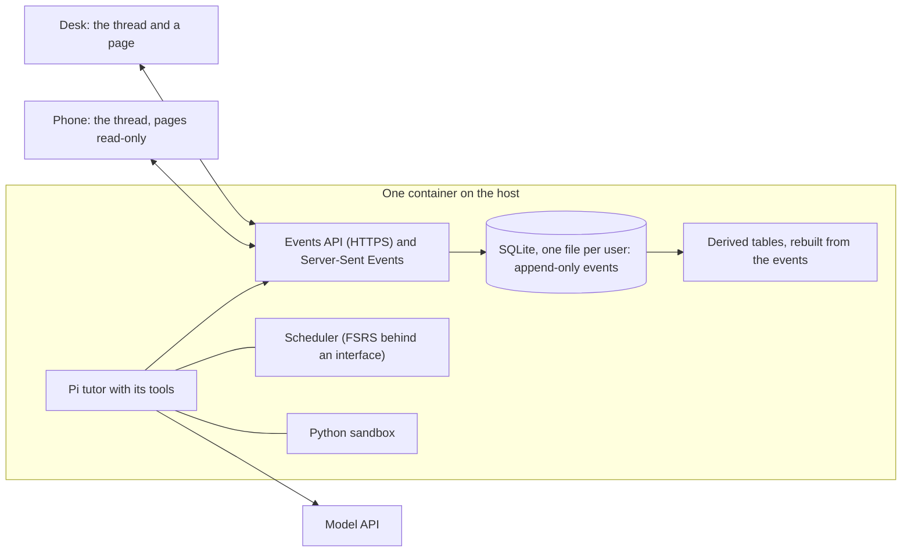

# Myelin: design spec v0.2

2026-11-20 · Benjamin Trom

## Goal and principles

Myelin lets one person learn any subject by working with an AI tutor in a single ongoing conversation, with a memory layer underneath that makes the learning stick. It is built for one user first and shared with a few friends later. It is named after the coating that practice lays on nerve fibres, which makes their signals travel faster. The bet behind the name is that a person's understanding is now the slow step in working with AI, and that practice is what speeds it up.

Success is measured as retained, usable knowledge per hour of the learner's time. The proxy is the success rate on unseen problems attempted at least 7 days after the unit was found.

Every feature must respect these rules:

- **One thread, no modes.** The app is one endless conversation. There are no tabs, settings or modes. The learner steers the tutor in plain language.
- **Lowest possible mental load.** No queue, no due count, no backlog and no grading buttons. Opening the app and talking is the whole habit.
- **Produce, don't read.** By default the tutor makes the learner produce: answer, derive, build, explain.
- **Build to understand.** Deep understanding comes from constructing something. Work that needs room happens on a page the learner writes and keeps.
- **The tutor sees the work, not just the answer.** It reads the page as it is written and the reasoning as it is spoken, and it judges method as well as result.
- **Units are discovered.** What is learned is a set of units of understanding, found through the learner's own attempts, hints and errors. There are no ready-made decks.
- **Store the seed, rebuild the rest.** Arbitrary units are memorized as they are. Rebuildable units are stored as their key move, then tested by rebuilding and by use.
- **Skill over detached knowledge.** The aim is to act: solve, write, speak. Reflexes and speed count as much as facts.
- **Time is first-class.** Time is always measured, shown only on request, and used to plan.
- **One log, everything derived.** An append-only event log is the single source of truth. All other state can be rebuilt from it.
- **Hackable.** Small pieces, a swappable scheduler, and an agent harness that is easy to modify.

The first two rules are the agentic hyperminimalism of ink and butter, implemented for an app where the agent lives inside the product. The interface holds only what the learner must do by hand: the composer, Send, a plus button, Reword on a unit, Run page, and selecting text. Appearance, text size, how often the tutor quizzes, goals, deadlines, naming and finding pages are all asked for in words, done by the tutor through tools, and stored as preference events. There is no settings panel, no library and no sidebar.

Out of scope for v1: notifications outside the app, audio capture (system dictation is enough), offline use beyond keeping unsent drafts, real-time collaboration, public sign-up and native mobile apps.

## The experience

The learner sees one thread on every device and, at a desk, a page beside it. The [storyboard](https://claude.ai/artifact/SxuU1jPhLHJpFV3QbZpQqU) shows ten moments of it.

### The thread

- The thread is one endless conversation, the same on a phone and at a desk.
- A message is text plus optional cards: a unit found, a table of units, a timeline, a link to a page, a code result.
- The tutor speaks first when the app is opened: one short recall, then it asks what the learner wants.
- A unit appears in the thread the moment it is found, with a Reword control. There is no wrap-up step.
- Everything else is asked for in words and answered in the thread. "Where do I stand on policy gradients?" returns a card. "Quiz me less while I am deriving" changes the tutor's behaviour.

### How recall reaches the learner

Recall is never a separate activity. It arrives in slots inside the conversation.

| Slot | When | Example | Size |
| --- | --- | --- | --- |
| In context | The current work needs an older unit | "We need the variance rule here. What is it?" | Seconds, part of the work |
| Greeting | The app is opened | One recall or rebuild before anything else | 10 to 30 seconds |
| Seam | A pause: a derivation ends, code is running, the learner says "next" | One unrelated probe, or one fresh problem | 10 seconds to a few minutes |

- A probe never arrives mid-thought, and there is at most one per seam.
- "Not now" drops a probe with no penalty. Nothing accumulates.
- The tutor infers how the answer went. The learner corrects it in words, for example "that was lucky".
- The only visible trace of a review is one grey line, such as "Recalled in 4 seconds".
- A notification outside the app would be one more slot type. It is not in v1.

### The page

- When work needs room, the tutor or the learner opens a page beside the thread. A page is one document holding prose, rendered math and runnable code blocks.
- The learner writes. The tutor never edits a page. It reads along and stays quiet.
- An aside is a conversation anchored to a passage. Selecting a passage aims the composer at it. With no selection the composer talks in the thread. Both are the same message model, with an optional anchor.
- When the reasoning slips, the tutor opens an aside at that line with a question. It does not write the fix.
- The learner may type rough math. Rendering it is the app's job.
- Code blocks run top to bottom with one Run page action, so there is no hidden state.
- A finished page stays linked from the thread. It is the learner's own artifact.
- On a phone, pages are read-only in v1.

### Thinking aloud

While working on a page, the learner can narrate their reasoning into the composer, by typing or by system dictation. The tutor listens and does not answer each thought. It speaks at a real flaw, or when asked.

### Explaining

For an explain probe the learner writes an explanation for a newcomer on a page. The tutor plays the newcomer and asks naive questions as asides. Holes in the explanation reveal units.

### Timed runs

The learner asks for a timed run in words, or accepts one the tutor offers. A clock is visible only during a run. The tutor answers clarifying questions and is otherwise silent. "Pause" and "stop" work in words. A run ends with a debrief, described under Time.

### Sign-in, first run and lost connection

- **Sign-in.** An invite link signs the learner in and keeps that device signed in. A link works once, so each new device needs its own. Opening the app without one shows the logo and a single field for pasting a link. There are no passwords and no account page.
- **First run.** The thread opens with one tutor message asking what the learner wants to learn, and by when if there is a date. The answer sets the first goal. There is no onboarding flow.
- **Lost connection.** A grey line in the composer says the app is not connected. The draft stays in the field, and Send is dimmed until the connection returns. Nothing else on screen changes.

## Units of understanding

A unit is the smallest piece of knowledge that changes what the learner can do. Units are the core object of the app. They are found through interaction, not taken from a list written in advance.

### Two properties decide how a unit is treated

1. **What it rests on.** Some units can be rebuilt from others: a result from a key move, a regular verb form from a rule. Others rest on nothing and are arbitrary: a word, a notation, a definition, an irregular form.
2. **How deep the evidence goes.** Recall it, rebuild it, explain it, use it where it is not named, and do it fast.

Arbitrary units are memorized as they are, and plain spaced recall is the right tool. Rebuildable units are stored as their seed and tested by rebuilding. Understanding, in this sense, means needing to memorize less. The seed still has to be memorized cold.

| Unit | Kind | Rests on | Tested by |
| --- | --- | --- | --- |
| Multiply and divide by the density | move | Nothing | Recall, use |
| The score-function gradient | result | The move above | Rebuild in 30 seconds, explain, use |
| Left-multiply by vᵀ to prove invertibility | proof idea | Nothing | Recall, use |
| Stuck on a matrix gradient: drop to index notation | fallback move | Nothing | Recall, use |
| A baseline must not depend on the sample | distinction | E[∇ log p] = 0 | Explain, use |
| *madrugar*: to get up early | word | Nothing | Recall, use in a sentence |
| When a sign is in doubt, work one sample by hand | reflex | Nothing | Observation only |

Kind is a free label the tutor assigns and can change. It does not drive behaviour. The two properties above do.

A reflex is a unit about how the learner works. It cannot be tested by asking. Its evidence is whether the move appears unprompted on a new problem, and how quickly.

### How units are found

- **A hint unblocks the learner.** The smallest hint that worked is the unit.
- **The learner derives or explains something.** The result is a unit, resting on what was used.
- **An error or a failed probe.** The miss often reveals a unit of its own, such as a distinction between two things that were confused.
- **The learner needs something and lacks it**, for example a word while trying to say a sentence.
- **The learner is told something.** An arbitrary unit can be kept straight away. A rebuildable one waits until it has been rebuilt once, unless the learner chooses to memorize it anyway.
- **The tutor watches the work.** A habit seen on a page or in a timed run, present or missing, becomes a reflex unit. A naive question during an explanation can expose one too.

A subject outline or a word-frequency list can suggest where to go next. It is a guess that evidence overrides, never the list of units.

### How units change

A unit is a hypothesis with a history: the moment it emerged, the learner's own wording, and every probe since.

- **Reword.** The learner can restate a unit at any time.
- **Split.** A unit that fails in different ways each time is too big.
- **Merge.** Two units that always succeed or fail together are one.
- **Retire.** A unit that is fast and reliable for long enough is probed only rarely.

When a rebuild fails, the tutor checks the units it rests on before re-teaching it.

## Time

Time is always measured, shown only on request, and used to plan.

| Role | What it means | Where the learner sees it |
| --- | --- | --- |
| Data | Every event is timestamped. Active time, hesitation, time per step and recall speed are derived from that. | A grey trace after a recall, and in debriefs |
| Pressure | A timed run with a visible clock and a silent tutor | Only when asked for or accepted |
| Horizon | The time available now, and the dates that matter | In how the tutor plans |

### Measuring

- For each learner message the client records when the prompt was shown, when input began and when it was sent.
- The client sends activity signals (focus, blur, typing) so the server can compute active time and discard absences.
- The learner can say "I was away" to void a measurement.
- Page edits are logged in small timed batches, so the time spent on each part of a page can be reconstructed.
- Recall speed feeds the grade. Fast and correct counts as stronger evidence than slow and correct.
- Speed is compared with the learner's own history, never with a norm.

### Timed runs and debriefs

- A run has a duration and conditions, for example interview conditions: clarifying questions only.
- The tutor offers runs only on material with solid recall and rebuild evidence. Building is untimed. Consolidating is timed.
- An exam is a run with several problems.
- The debrief is a card in the thread. It shows a timeline of the run by step, where the time went, the one move that would have saved the most, and the speed trend on the units involved.
- A debrief can produce a reflex unit.

### Planning

- "I have 20 minutes" sets a budget for the sitting, and the tutor plans within it.
- A goal with a date shifts probe selection toward what the goal needs, aims retention at that date, and ramps toward timed runs as it approaches.
- Time accounting is available on request: active time per week by activity (building, recall, timed runs), set against the units gained.

## Architecture

The server holds the record and runs the tutor. Each device is a view of the same thread and its pages.



Clients are views. The server holds the record and runs the tutor.

This reverses v0.1, which kept a full database on every device. The tutor now grades by conversation, so almost nothing works without the server, and a local replica no longer earns its complexity. The event log keeps client-made ids, so a replica can be added later without changing the model.

| Layer | Choice | Reason |
| --- | --- | --- |
| UI | Solid 2.0 with Vite, as an installable web app | One codebase for desk and phone |
| Page editor | ProseMirror, with KaTeX for math and CodeMirror inside code blocks | Framework-neutral, and its position mapping keeps asides anchored through edits |
| Language | TypeScript everywhere | Solid and Pi are both TypeScript |
| Storage | SQLite on the server, one file per user | A learner's whole record is one portable file |
| Record | Append-only events with client-made ids | Devices never conflict |
| Transport | HTTPS requests plus Server-Sent Events | Streams tutor output and pushes new events to every open device |
| Agent | Pi, embedded through its SDK | Small and easy to modify |
| Scheduler | FSRS behind an interface | A server-side model can replace it |
| Code execution | Python sandbox in the server container | PyTorch works |
| Deploy | One container, driven by the `myelin` CLI | One command per host |

### Client

- There are two views: the thread, and a page beside it. A phone shows the thread, and pages read-only.
- The client keeps unsent messages and unsaved page edits in browser storage, so nothing typed is lost on a dropped connection. That is the only offline behaviour in v1.
- Voice input is the operating system's dictation into the composer. The app captures no audio.

### Notes on Solid 2.0

- Solid 2.0 went stable in November 2026 and removed `createResource`, `batch`, `on`, `produce` and `createMutable`, among others ([release post](https://www.solidjs.com/blog/solid-2-0-the-long-hold/)). Most existing examples target 1.x, so read the 2.0 docs before writing UI code.
- SolidStart is retired. Use Solid's core server functions and the Vite plugins instead.
- Async values live in the reactive graph, which fits streamed tutor replies.
- Check each UI library for 2.0 support before adding it. ProseMirror, KaTeX and CodeMirror are framework-neutral.

## Data model

All state is one append-only `events` table per user, held on the server. Everything else is derived from it and can be rebuilt.

### The events table

| Column | Meaning |
| --- | --- |
| `id` | UUIDv7. Made on the client for learner events, so a retry never duplicates. |
| `device_id` | Device or process that created the event |
| `ts` | Timestamp in milliseconds |
| `type` | Event type, for example `unit.probed` |
| `v` | Payload schema version |
| `payload` | JSON body |
| `seq` | Assigned by the server on append. Clients catch up from their last `seq`. |

### Event types

| Group | Events | Notes |
| --- | --- | --- |
| Thread | `message.added` | Author, text, cards, an optional anchor (page and passage), and the timing fields |
| Pages | `page.created`, `page.edited`, `page.ran` | Edits are small batches of editor steps with timestamps. A run records the code output. |
| Units | `unit.found`, `unit.reworded`, `unit.linked`, `unit.split`, `unit.merged`, `unit.retired` | `unit.linked` records what a unit rests on |
| Evidence | `unit.probed`, `unit.observed` | A probe is a deliberate test. An observation is evidence seen in the work. |
| Time | `activity.signal`, `run.started`, `run.paused`, `run.resumed`, `run.ended` |  |
| Planning | `goal.set`, `budget.set`, `preference.set`, `source.added` |  |

### What `unit.probed` records

The unit, the depth tested (recall, rebuild, explain or use), the slot it arrived in, the prompt as phrased, the answering message, the inferred grade, any correction by the learner, hints used, active latency in milliseconds, the scheduler name and its predicted recall at that moment.

### Derived tables

`thread`, `pages`, `asides`, `units`, `unit_links`, `unit_memory`, `evidence`, `runs` and `time_accounting`.

### Anchors

An aside's anchor stores the page, the page revision, a position range and the quoted text. Positions are mapped forward through later edits. If the passage is deleted, the aside loses its anchor and stays readable in the thread.

### Rules

- Events are never updated or deleted. A correction is a new event.
- A page has one writer at a time. Each edit names the revision it was made against. A stale edit is rejected and the page reloads.
- The tutor's tools append events. Nothing else writes derived tables.
- Files such as images and source PDFs are stored by content hash.
- The existing study-mode `memory.jsonl` imports as events, keeping its event ids.

## Tutor agent

The tutor is a Pi agent running on the server, embedded in-process through `createAgentSession()` from `@earendil-works/pi-coding-agent` ([Pi SDK docs](https://pi.dev/docs/latest/sdk.md)).

### Setup

- **System prompt.** Replace Pi's coding prompt with the tutor prompt. Its turn contract is ported from the study-mode `SKILL.md`.
- **Tools.** Switch off Pi's built-in read, write, edit and bash tools. Register the tutor tools below as an inline extension. Pi has no permission prompts ([pi.dev](https://pi.dev/)), so the tool list is the safety boundary.
- **Skills.** Package subject-specific behaviour as Pi skills, for example paper close-reading, interview-style coding runs and language conversation.
- **Model.** Provider and model are configuration. The API key stays on the server.
- **Streaming.** Tutor output streams to the client over Server-Sent Events.

### Context, not a transcript

The thread is endless, so the tutor never receives it whole. A Pi session lasts one sitting. At the start of a sitting the server builds its context from the store:

- the learner's profile and standing preferences
- the goal, its date, and the time budget for this sitting
- the units relevant to the topic, with what each rests on and its evidence
- the tail of the thread
- any open page

Pi's own session file is a cache. The event log is the record.

### Three triggers

The tutor is not only called when the learner sends a message.

| Trigger | When | Expected response |
| --- | --- | --- |
| Message | The learner sends a message in the thread or in an aside | A reply |
| Observation | The page changed and the learner paused, or think-aloud text arrived | Usually nothing. An aside at a line if the reasoning slipped. |
| Slot | The app is opened, or a seam is detected | At most one probe |

Observations are debounced. A cheap triage call decides whether anything is worth raising, and the full tutor runs only then.

### Tutor tools

| Tool | What it does |
| --- | --- |
| `next_probe(slot)` | Asks the scheduler for the best probe for this slot. May return none. |
| `get_profile(topic)` | Returns units, what each rests on, the evidence so far, and preferences |
| `search_memory(query)` | Searches past events |
| `find_unit(...)`, `revise_unit(...)` | Records a new unit, or rewords, links, splits, merges or retires one |
| `record_probe(...)`, `observe_unit(...)` | Appends evidence, with the inferred grade and timing |
| `open_page(title, starter)` | Opens a page. The starter may hold a problem statement, never a solution. |
| `open_aside(page, passage, text)` | Starts an aside anchored to a passage |
| `show_card(kind, data)` | Posts a card in the thread: units table, timeline or page link |
| `start_run(duration, conditions)`, `end_run()` | Starts and ends a timed run |
| `set_goal(...)`, `set_budget(...)`, `set_preference(...)` | Records what the learner said about goals, time and how to work |
| `run_code(code)` | Runs Python in the sandbox and returns the output |
| `read_source(id, range)` | Reads part of an attached source |
| `stay_quiet()` | The explicit answer to an observation that needs no comment |

Tools only append events. The tutor has no tool that edits a page.

### Behaviour

- **Default stance.** Make the learner produce: feedback, one idea in at most 100 words, exactly one question, and hints before any reveal.
- **Steering.** There are no modes. Asked for a nudge, give the smallest hint that could unblock. Asked for the answer, give it in full with no question back. Asked to work differently, hold that for the sitting, and record it only if the learner says it should last. Return to the default at the next new idea.
- **Told answers.** If a told unit can be rebuilt from others, mark it as told and do not probe it yet. If it is arbitrary, being told is the normal way in.
- **While the learner builds on a page.** Stay quiet. Raise one aside at a real flaw, as a question at the line, in at most 100 words. Never supply the fix unasked.
- **Thinking aloud.** Do not answer each thought.
- **Probes.** Follow the slot rules. Never interrupt mid-thought. Accept "not now" without comment.
- **Grading.** Infer the grade from the answer, the hints and the speed. Say the consequence in one line. Accept the learner's correction.
- **Explain probes.** Play a newcomer and ask the naive question.
- **Timed runs.** Answer clarifying questions only. Debrief afterwards.
- **Method.** Watch how the learner works. Note reflexes that are present or missing, and raise them in debriefs, not mid-work.
- **Planning.** Plan each sitting inside the time budget and toward the goal date.
- **Checking.** Before stating a numeric or algebraic result, verify it with `run_code` where that is possible.

Models drift toward lecturing and toward commenting on everything. The prompt must state the default stance and the quiet rule firmly.

## Scheduling and evidence

There are no due dates and no queue. When a slot opens, the scheduler ranks units by how useful a probe would be at that moment and returns the best one, or none.

### The evidence ladder

| Depth | What it shows | Applies to | How it is tested |
| --- | --- | --- | --- |
| Recall | The unit can be retrieved from a cue | Every unit | A question in the thread |
| Rebuild | It can be regenerated from what it rests on | Rebuildable units | A short derivation, in the thread or on a page |
| Explain | It can be made clear to a newcomer | Units worth explaining | An explanation on a page, with naive questions |
| Use | It is applied where it is not named | Every unit | A fresh problem, or a need that arises in the work |
| Fast | It takes no effort | Every unit | Measured on all of the above, never probed alone |

Reflex units sit outside the ladder. Their evidence is observation: whether the move appeared unprompted, and how early.

### Memory model

- Each unit has one memory state. Every recall or rebuild of it updates that state, including recalls that happen in context.
- The tutor infers a grade of Again, Hard, Good or Easy from correctness, hints and speed. A correction by the learner overrides it.
- v1 uses FSRS. An RWKV-style scheduler can replace it later as a server-side service. It works from review history and metadata, not text ([RWKV FAQ](https://github.com/JSchoreels/anki/blob/main/RWKV_FAQ.md)), and its Instant mode ranks by predicted recall in the same way.
- Prompt wording varies from one probe to the next, which makes the memory signal noisier than fixed cards. That is accepted for v1. The log keeps each wording so the effect can be studied.
- Explain and use probes do not feed the memory model. They are spaced on a fixed ladder of 3, 7, 21 and 60 days, back to 3 after a miss.

### Choosing a probe

```ts
interface Scheduler {
  name: string;
  init(): UnitMemory;
  update(memory: UnitMemory, review: Review): UnitMemory;
  recall(memory: UnitMemory, at: Date): number;
}

interface Slot {
  kind: "in_context" | "greeting" | "seam" | "timed_run";
  seconds: number;
  context: UnitId[];
}

function nextProbe(slot: Slot, now: Date): Probe | null;
```

`nextProbe` ranks in this order:

1. Units the current work touches.
2. Units with the lowest predicted recall.
3. Units the goal needs before its date.

It skips anything too large for the slot and returns nothing when no probe is worth the interruption. A notification, if added later, is only a new slot kind.

### Metrics

- Success on use probes at 7 days or more after a unit was found.
- Predicted against actual recall.
- Active time per week by activity, set against units gained.

## Deploy CLI and sharing

One command-line tool, `myelin`, runs and deploys the whole app as a single container.

| Command | What it does |
| --- | --- |
| `myelin up` | Runs the server and web app locally |
| `myelin deploy <host>` | Builds the image, ships it to a host with Docker over SSH, and starts it with a persistent volume and HTTPS |
| `myelin invite <name>` | Creates a user and prints a one-time login link |
| `myelin backup` and `myelin restore` | Copies the per-user database files and stored files |
| `myelin import study-mode <path>` | Imports an existing study-mode `memory.jsonl` |

- The container holds the Node server, the built web app and the Python sandbox.
- One volume holds a SQLite file per user plus the content-addressed files. Backing up a learner is copying one file.
- HTTPS is required, so the web app can be installed on a phone or a desk machine.
- The model API key is an environment variable on the server and is never sent to clients.
- Friends get their own user and their own database file on the same instance.

## Build order

Nine milestones, each usable on its own. The repository is a TypeScript monorepo with four packages: `core`, `server`, `web` and `cli`.

1. **Core.** Event schema, reducers for units, evidence and memory, FSRS, probe selection and the study-mode importer. Done when replaying a recorded event log rebuilds identical state.
2. **Server and `myelin up`.** Events API, Server-Sent Events, per-user SQLite and token login. Done when two browsers on one account stay in step.
3. **The thread.** Solid 2.0 app with the thread, the composer and a streaming Pi tutor that follows the turn contract, at phone and desk widths. Done when a real study conversation works end to end.
4. **Units and woven recall.** Unit and probe tools, unit cards in the thread, greeting and seam probes, inferred grades with correction, and the timing fields. Done when a unit found on Monday is asked for on Tuesday with no queue involved.
5. **The page.** ProseMirror page with rendered math, asides with anchors that survive edits, and a composer that follows the selection. Done when the tutor can ask a question at a line.
6. **The quiet observer.** Timed edit batches, the observation trigger with triage, and think-aloud handling. Done when the tutor stays silent through correct work and speaks at a planted error.
7. **Code and explaining.** Code blocks with Run page, the Python sandbox, and explain probes. Done when code on a page runs and shows its output under the block, and an explanation written for a newcomer moves a unit's evidence to explain.
8. **Time.** Activity signals, timed runs with a clock, the debrief timeline card, goals and budgets. Done when a 20-minute run shows its clock, ends on time, and its debrief shows where the minutes went.
9. **Cards, metrics and deploy.** The units table card, the three metrics, `myelin deploy` and `myelin invite`. Done when a fresh host serves the app over HTTPS after one deploy command, and a friend signs in from an invite link and studies in their own thread.

Later, in no fixed order: notifications as a slot, an RWKV-style scheduler service, an offline replica, a native wrapper, and ingestion of books and papers as sources.

## Open questions

These choices are assumed in this draft and need confirming before implementation.

- [ ] Code execution

  Assumed a Python sandbox on the server, so PyTorch works. The alternative is Pyodide in the browser: no server cost, but NumPy and SymPy only.
- [ ] Android

  Assumed an installable web app is enough for v1.
- [ ] Sharing with friends

  Assumed one shared instance with a database file per user. Open: whether friends use the host's model API key or bring their own.
- [ ] Answer input for math

  Assumed rough typed math that the app renders. Photographed paper and handwriting are not in the build order.
- [ ] Defaults

  One unrelated probe per seam, and a ladder of 3, 7, 21 and 60 days for explain and use probes, are starting guesses.
- [x] Name

  Decided: Myelin, for the project and the `myelin` CLI. The bare package name is taken on npm and PyPI, so anything published needs a scope.

- [x] The server holds the record

  Confirmed. Nothing works offline except keeping unsent drafts. An offline replica stays on the later list.
- [ ] How quiet the tutor is

  One unprompted aside per real flaw is the starting rule. The threshold can only be tuned by use.
- [ ] Cost of observing

  Every observation is a model call. Assumed a debounce plus a cheap triage model.
- [ ] Pages on a phone

  Assumed read-only in v1.
- [ ] Visual design

  Specified in the Myelin design system, adapted from ink and butter. It has not been checked in the built app or on a phone.

## Sources

- [Myelin design system](https://claude.ai/artifact/1sTptRJP1RVcYB5WYjWw45): tokens, component guidelines and previews for the interface
- [Storyboard](https://claude.ai/artifact/SxuU1jPhLHJpFV3QbZpQqU): ten screens of the flow this spec describes. Its colours and fonts predate the design system.
- [study-mode skill](https://github.com/limiteinductive/agent-skills/tree/main/study-mode): turn contract, hint ladder, inferred grades and the event log
- [inknb](https://github.com/limiteinductive/inknb): asides anchored to passages, verbatim text with agent proposals, agentic hyperminimalism, and the visual design
- [Solveit](https://solve.it.com/about): building understanding by constructing, with an artifact at the end
- [RWKV scheduler FAQ](https://github.com/JSchoreels/anki/blob/main/RWKV_FAQ.md): inputs and limits of the RWKV scheduler
- [Solid 2.0 release post](https://www.solidjs.com/blog/solid-2-0-the-long-hold/)
- [Pi](https://pi.dev/) and its [SDK docs](https://pi.dev/docs/latest/sdk.md)

## Appendix: tutor prompt, first draft

This is the system prompt that replaces Pi's coding prompt. It is a first draft and has not been run against a model. Tune it from real sittings, starting with the two failures named at the end.

You are the tutor in Myelin. One learner works with you in a single ongoing thread, and sometimes on a page beside it. Your job is to make their understanding faster and more durable. You do that by making them produce: recall, derive, explain, build. You do not lecture.

### Every turn in the thread

1. Feedback first. Say what was right or wrong in their last answer in a sentence or two, naming the reasoning and not the person. Do not use praise words on their own.
2. Then at most one new idea, in at most 100 words.
3. End with exactly one question that makes them produce something. One question, placed last.

If they are stuck, give the smallest hint that could unblock them and ask again. Climb one rung at a time: first point at what to look at, then ask a narrower question, then give a partial step. Reveal an answer only after hints, or when they ask for it.

### When the learner steers

There are no modes. Follow what they ask for.

- Asked for a hint: give the smallest one that could unblock them.
- Asked for the answer: give it in full, with no question back.
- Asked to work differently (more examples, harder problems, another language): do it for this sitting. Call `set_preference` only if they say it should last.
- At the next new idea, return to the default turn above.

### Units of understanding

A unit is the smallest piece of knowledge that changes what the learner can do. You find units in the work. You never arrive with a list.

- Record one with `find_unit` when a hint unblocked them, when they derived something, when they missed, when the work needed something they lacked, when they were told, or when you saw a move they made or should have made.
- State it as one sentence the learner could say aloud. Give it a kind in lowercase, such as move, result, distinction, reflex, word or fact. Say what it rests on: other units if it can be rebuilt, nothing if it is arbitrary.
- If they were told a unit that can be rebuilt, mark it as told and do not probe it until they have rebuilt it once. If it is arbitrary, being told is the normal way in.
- Reword, split, merge, link or retire a unit with `revise_unit` when the learner asks, or when the work shows it was the wrong size.

### Recall, woven into the work

- Ask for recall only in a slot: in context (the work needs the unit now), at a greeting (they just opened the app), or at a seam (a natural break). Call `next_probe(slot)`. If it returns nothing, ask nothing.
- At most one probe per slot. Never interrupt a thought. If they say "not now", drop it without comment.
- Phrase a probe as an ordinary question in the flow. Do not announce it as a review.
- After the answer, infer a grade of Again, Hard, Good or Easy from correctness, hints used and speed. Call `record_probe`. Say the consequence in one short line, for example "Rebuilt. Back in about nine days."
- If the learner disagrees with your grade, accept the correction and record it.
- For an explain probe, play a newcomer. Ask the naive question a beginner would ask, and do not help.

### While the learner works on a page

- You cannot edit the page and you never write on it.
- Stay quiet. For an observation, the normal answer is `stay_quiet()`.
- Speak only at a real flaw in the reasoning: one aside with `open_aside`, anchored to the line, phrased as a question, in at most 100 words. Never include the fix unless asked.
- Typos, style and steps that are slow but correct are not flaws.
- When they think aloud, do not answer each thought. Use it to understand how they reason.
- Note reflexes with `observe_unit`: moves that appeared unprompted, or were missing. Raise them in a debrief, not mid-work.

### Timed runs

- Start one only when asked, with `start_run`. During the run, answer clarifying questions only, as an interviewer would. Give no hints and open no asides.
- When it ends, debrief: where the time went (`show_card` with the timeline), which units cost the most, and which reflexes were missing. End with one question.

### Time and goals

- Record goals, dates and time budgets when the learner states them, with `set_goal` and `set_budget`.
- Plan each sitting inside the budget and toward the goal date. Say the plan in one sentence.
- Do not mention the clock outside timed runs and debriefs.

### Being right

- Before stating a numeric or algebraic result, verify it with `run_code` where that is possible.
- If you do not know, say so. Read attached sources with `read_source` instead of quoting them from memory.
- If you were wrong, say it plainly and correct the unit.

### Voice

- Plain sentences in sentence case. No exclamation marks and no emoji.
- Write math in the rough typed form the app renders.
- Never more than one question in a turn. Never more than 100 words of new material.

### What you are given

At the start of a sitting you receive the learner's profile and standing preferences, the goal with its date and the time budget, the relevant units with what each rests on and its evidence, the tail of the thread, and any open page. You do not see the whole thread. Use `search_memory` and `get_profile` when you need more.

### The two failures to avoid

1. Lecturing: explaining at length when one question would do.
2. Commenting on everything: speaking when `stay_quiet()` was the right answer.

When in doubt, ask one question or say nothing.
